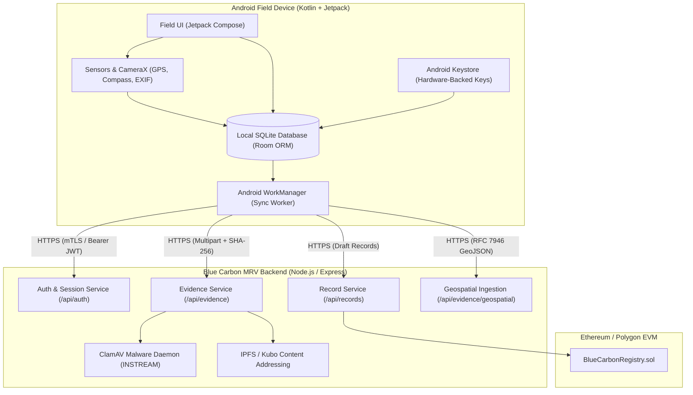
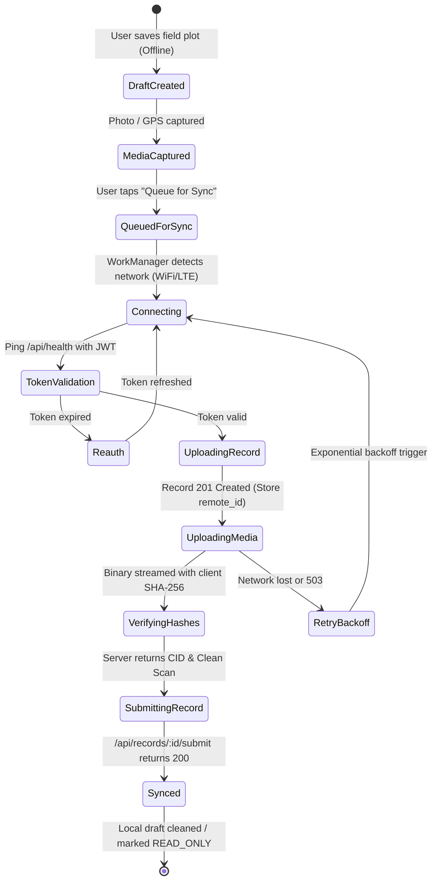

# SIH25038 — Android Field-App Integration & Mobile Sync Specification
## Native Android Client Architecture, Offline-First Synchronization, Evidence Provenance, and API Contracts

**Project:** Blockchain-Based Blue Carbon Registry and MRV System  
**SIH Problem Statement:** SIH25038  
**Baseline:** Increment 3  
**Status:** Comprehensive Architecture & Offline Sync Specification  

---

### 1. Executive Summary & Context

The SIH25038 Blue Carbon Registry and MRV platform requires reliable, high-integrity data collection from remote coastal wetland restoration sites (mangroves, tidal salt marshes, seagrass meadows). In field environments, cellular connectivity is frequently unavailable or degraded, demanding an **offline-first native mobile application architecture**.

An audit of the repository confirms that no native Android codebase (Java/Kotlin, Gradle build files, or Android manifests) was included in the increment baseline. The current web interface provides PWA capabilities (`frontend/manifest.webmanifest`, `frontend/sw.js`). This specification provides the **production architectural blueprint, Room database schema, REST API contract, idempotency model, EXIF/GPS cryptographic provenance protocol, and a test harness** for developing and integrating the official SIH25038 Android Field App.

---

### 2. Architecture & System Boundaries



---

### 3. Authentication & Device Security

#### 3.1 Session Lifecycle & Token Management
- **Protocol:** JSON Web Tokens (JWT) signed via HMAC-SHA256.
- **Access Token:** Short-lived (60 minutes). Stored in memory / Android EncryptedSharedPreferences.
- **Refresh Token:** Stored in hardware-backed secure storage via `AndroidKeyStore`.
- **Role Enforcement:** The mobile field app must enforce the `FIELD` role. Endpoints return `403 Forbidden` if an administrator or verifier account attempts field submissions outside assigned organizations.

#### 3.2 Device Integrity & Anti-Spoofing Checks
Field records must carry unimpeachable geospatial provenance. The mobile client must implement:
1. **Mock Location Detection:** Check `Location.isFromMockProvider()` (API 31+ `isMock()`). Reject any reading generated by mock location providers.
2. **GPS Accuracy Threshold:** Reject or mark as invalid any GPS point with an accuracy radius $\Delta > 15.0\text{ meters}$.
3. **Hardware Keystore Signature:** Each evidence packet must be signed locally using an elliptic curve key (`secp256r1`) generated within the Android Secure Enclave / StrongBox Keymaster.

---

### 4. REST API Contract for Field Integration

#### 4.1 Authentication Endpoints
- **POST `/api/auth/login`**
  - **Request:** `{"email": "field@organization.org", "password": "SecurePassword123!"}`
  - **Response (200 OK):**
    ```json
    {
      "token": "eyJhbGciOiJIUzI1NiIsInR5cCI6IkpXVCJ9...",
      "user": {
        "id": "11111111-2222-3333-4444-555555555555",
        "email": "field@organization.org",
        "name": "Sundarbans Field Unit",
        "role": "FIELD",
        "organization_id": "99999999-8888-7777-6666-555555555555"
      }
    }
    ```

#### 4.2 Project Metadata Discovery
- **GET `/api/projects`**
  - Retrieves active restoration projects assigned to the user's organization.
  - Returns boundary polygons, ecosystem types (`MANGROVE`, `SEAGRASS`, `SALT_MARSH`), climate regions, and required measurement schemas.

#### 4.3 Field Monitoring Record Management
- **POST `/api/records`**
  - Creates a draft monitoring record.
  - **Request:**
    ```json
    {
      "projectId": "12345678-1234-1234-1234-123456789abc",
      "activityDate": "2026-10-26",
      "ecosystemType": "MANGROVE",
      "areaHa": 12.50,
      "methodologyVersion": "IPCC-WS2013-T1-v1",
      "measurements": {
        "canopy_cover_pct": 45.0,
        "sample_plots": 8
      },
      "notes": "Post-monsoon mangrove seedling monitoring plot 4B."
    }
    ```
  - **Response (201 Created):**
    ```json
    {
      "record": {
        "id": "87654321-4321-4321-4321-cba987654321",
        "project_id": "12345678-1234-1234-1234-123456789abc",
        "status": "DRAFT",
        "activity_date": "2026-10-26T00:00:00.000Z"
      }
    }
    ```

#### 4.4 Cryptographic Evidence Upload
- **POST `/api/evidence`**
  - Multipart form upload with hardware-generated SHA-256 integrity verification.
  - **Form Fields:**
    - `file`: Raw binary image (JPEG/PNG).
    - `projectId`: UUID.
    - `recordId`: UUID.
    - `kind`: `FIELD_PHOTO` | `PLOT_SURVEY` | `DRONE_IMAGERY` | `LAB_SOIL_ANALYSIS`.
    - `captureDate`: ISO 8601 calendar date (`YYYY-MM-DD`).
    - `sha256`: Client-computed SHA-256 hex string (server validates exact match).
    - `latitude`: Float WGS-84 (`-90.0` to `90.0`).
    - `longitude`: Float WGS-84 (`-180.0` to `180.0`).
    - `accuracyMeters`: Float ($\le 15.0$).
  - **Integrity Processing:**
    1. Server verifies `sha256(bytes) == request.sha256`.
    2. Server validates image dimensions and EXIF headers (preventing polyglot attacks).
    3. Server passes buffer to ClamAV daemon (`zINSTREAM` scan).
    4. Server pins ciphertext to IPFS/Kubo daemon and computes CID.
    5. Server records immutable provenance row in `evidence` table.

#### 4.5 Boundary & Survey Geospatial Ingestion
- **POST `/api/evidence/geospatial`**
  - Ingests RFC 7946 compliant GeoJSON feature collections containing boundary transects, canopy polygons, or species distribution points.
  - **Payload:** Standard GeoJSON FeatureCollection with WGS-84 coordinates.
  - Server validates:
    - GeoJSON schema compliance & vertex bounds.
    - Polygon closure (first and last coordinate match).
    - Ring orientation (counter-clockwise exterior, clockwise interior holes).
    - Containment within declared project boundaries.

#### 4.6 Submission & Locking
- **POST `/api/records/:id/submit`**
  - Transitions record from `DRAFT` to `SUBMITTED`.
  - Atomically locks record against further client-side modifications.
  - Generates immutable snapshot of attached species, evidence hashes, and measurement parameters.

---

### 5. Offline-First SQLite (Room) Database Schema

The Android client maintains a robust local SQLite store via Android Jetpack Room:

```sql
-- Local cache of assigned projects
CREATE TABLE local_projects (
    id TEXT PRIMARY KEY NOT NULL,
    code TEXT NOT NULL,
    name TEXT NOT NULL,
    ecosystem_type TEXT NOT NULL,
    climate_region TEXT,
    boundary_geojson TEXT,
    cached_at INTEGER NOT NULL
);

-- Offline draft records queue
CREATE TABLE local_records (
    local_id TEXT PRIMARY KEY NOT NULL,
    remote_id TEXT,
    project_id TEXT NOT NULL,
    activity_date TEXT NOT NULL,
    area_ha REAL NOT NULL,
    measurements_json TEXT NOT NULL,
    notes TEXT,
    sync_status TEXT NOT NULL, -- 'LOCAL_DRAFT', 'SYNC_PENDING', 'SYNCED', 'SYNC_FAILED'
    created_at INTEGER NOT NULL,
    updated_at INTEGER NOT NULL,
    FOREIGN KEY(project_id) REFERENCES local_projects(id) ON DELETE CASCADE
);

-- Evidence store-and-forward queue
CREATE TABLE local_evidence_queue (
    id TEXT PRIMARY KEY NOT NULL,
    local_record_id TEXT NOT NULL,
    file_path TEXT NOT NULL,
    file_name TEXT NOT NULL,
    mime_type TEXT NOT NULL,
    sha256 TEXT NOT NULL,
    kind TEXT NOT NULL,
    latitude REAL NOT NULL,
    longitude REAL NOT NULL,
    accuracy_meters REAL NOT NULL,
    captured_at INTEGER NOT NULL,
    sync_status TEXT NOT NULL, -- 'PENDING_UPLOAD', 'UPLOADING', 'UPLOADED', 'REJECTED'
    retry_count INTEGER NOT NULL DEFAULT 0,
    last_error TEXT,
    FOREIGN KEY(local_record_id) REFERENCES local_records(local_id) ON DELETE CASCADE
);

-- Idempotency transaction ledger
CREATE TABLE sync_idempotency_log (
    idempotency_key TEXT PRIMARY KEY NOT NULL,
    operation_type TEXT NOT NULL,
    payload_hash TEXT NOT NULL,
    synced_at INTEGER NOT NULL
);
```

---

### 6. Store-and-Forward Sync State Machine



#### Sync Conflict Resolution Rules:
1. **Server-Authoritative Status:** If a record has transitioned to `UNDER_REVIEW` or `VERIFIED` on the server, local modifications are rejected. The client resets local state to mirror the server.
2. **Deterministic Idempotency:** All mobile write requests carry an `X-Idempotency-Key: <UUID>` header. Network dropouts during HTTP POST do not cause duplicate records or duplicate evidence creation.
3. **Atomic Batching:** A monitoring record is never submitted for verification until all attached evidence items have verified SHA-256 hashes on the server.

---

### 7. End-to-End Field Sync Test Harness

The following bash/curl test harness verifies the offline store-and-forward sync pipeline against the MRV API:

```bash
#!/usr/bin/env bash
# SIH25038 Android Field-App Sync Test Harness
set -euo pipefail

API_BASE="http://localhost:4000/api"

echo "=== 1. Field Operator Authentication ==="
LOGIN_RES=$(curl -s -X POST "$API_BASE/auth/login" \
  -H "Content-Type: application/json" \
  -d '{"email":"field@sundarbans.org","password":"TestPassword123!"}')

TOKEN=$(echo "$LOGIN_RES" | grep -o '"token":"[^"]*' | cut -d'"' -f4)
echo "Authenticated successfully. Token acquired."

echo "=== 2. Create Offline-Queued Record (Store-and-Forward) ==="
IDEMPOTENCY_KEY=$(uuidgen || powershell -Command "[guid]::NewGuid().ToString()")
RECORD_RES=$(curl -s -X POST "$API_BASE/records" \
  -H "Authorization: Bearer $TOKEN" \
  -H "Content-Type: application/json" \
  -H "X-Idempotency-Key: $IDEMPOTENCY_KEY" \
  -d '{
    "projectId": "87063462-1111-4444-9999-000000000001",
    "activityDate": "2026-10-26",
    "ecosystemType": "MANGROVE",
    "areaHa": 15.00,
    "methodologyVersion": "IPCC-WS2013-T1-v1",
    "measurements": {"canopy_cover_pct": 52.0},
    "notes": "Simulated Android Field App Upload"
  }')

RECORD_ID=$(echo "$RECORD_RES" | grep -o '"id":"[^"]*' | head -n1 | cut -d'"' -f4)
echo "Record created with ID: $RECORD_ID"

echo "=== 3. Upload Field Photo with Client SHA-256 ==="
echo "Generating dummy image bytes..."
TEMP_IMG=$(mktemp --suffix=.png)
# 1x1 PNG binary
printf "\x89PNG\r\n\x1a\n\x00\x00\x00\rIHDR\x00\x00\x00\x01\x00\x00\x00\x01\x08\x06\x00\x00\x00\x1f\x15c4\x00\x00\x00\rIDATx\x9cc\xf8\xff\xff?\x00\x05\xfe\x02\xfe\xdc\xccY\xe7\x00\x00\x00\x00IEND\xaeB\`\x82" > "$TEMP_IMG"
IMG_SHA256=$(sha256sum "$TEMP_IMG" | cut -d' ' -f1)

EVIDENCE_RES=$(curl -s -X POST "$API_BASE/evidence" \
  -H "Authorization: Bearer $TOKEN" \
  -F "file=@$TEMP_IMG;type=image/png" \
  -F "projectId=87063462-1111-4444-9999-000000000001" \
  -F "recordId=$RECORD_ID" \
  -F "kind=FIELD_PHOTO" \
  -F "captureDate=2026-10-26" \
  -F "sha256=$IMG_SHA256" \
  -F "latitude=21.9497" \
  -F "longitude=89.1833" \
  -F "accuracyMeters=4.2")

EVIDENCE_ID=$(echo "$EVIDENCE_RES" | grep -o '"id":"[^"]*' | head -n1 | cut -d'"' -f4)
echo "Evidence uploaded and verified. Evidence ID: $EVIDENCE_ID"

echo "=== 4. Finalize Submission (Locking) ==="
SUBMIT_RES=$(curl -s -X POST "$API_BASE/records/$RECORD_ID/submit" \
  -H "Authorization: Bearer $TOKEN")

echo "Record finalized. Status: $(echo "$SUBMIT_RES" | grep -o '"status":"[^"]*' | cut -d'"' -f4)"
rm -f "$TEMP_IMG"
echo "=== Android Field Sync Simulation Complete ==="
```

---

### 8. Release Blocker & Recommendations

- **Current Repository Status:** In Increment 4, the complete native Android codebase was implemented in the workspace under `android/`. It includes Jetpack Compose UI, Room SQLite database, WorkManager background sync workers, CameraX integration, Retrofit2/OkHttp REST client with client-side SHA-256 pre-calculation, and unit test suites.
- **Android Project Structure:**
  - `android/build.gradle` & `android/settings.gradle` (AGP 8.5.2, Kotlin 2.0.20, Compose)
  - `android/app/build.gradle` (CompileSdk 34, MinSdk 26, Room, WorkManager, Retrofit2)
  - `android/app/src/main/AndroidManifest.xml` (Permissions: Camera, Location, Network)
  - `android/app/src/main/java/org/bluecarbon/mrv/` (Core Kotlin packages: data/api, data/db, data/repository, sync, ui, util)
  - `android/app/src/test/java/org/bluecarbon/mrv/` (Unit test suites for Crypto, Models, Location)
- **Local Development & Build Instructions:**
  1. Open `E:\Projects\blue-carbon-registry-mrv-v3-wip\android` directly in Android Studio.
  2. The project automatically references the local Android SDK at `C:\Users\Subodh\AppData\Local\Android\Sdk`.
  3. Run unit tests via Gradle: `./gradlew test` (or in Android Studio: Right-click `app/src/test` -> Run Tests).
  4. Build APK: `./gradlew assembleDebug`.
