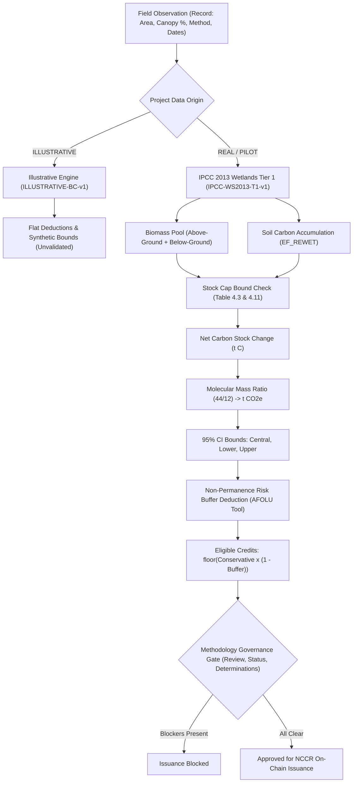

# SIH25038 — MRV Scientific Validation Document
## Parameter Provenance, Mathematical Foundations, Accounting Boundaries and Review Protocol

**Project:** Blockchain-Based Blue Carbon Registry and MRV System  
**SIH Problem Statement:** SIH25038  
**Scope:** Monitoring, Reporting, and Verification (MRV) Scientific Baseline  
**Date:** 2026-10-26  
**Status:** Software Implementation Validated · Scientific Methodology Review Pending (Non-Operational for Live Issuance)

---

### 1. Fundamental Principle & Regulatory Warning

> **CRITICAL SCIENTIFIC & REGULATORY NOTICE:**  
> Software passing automated unit, integration, and end-to-end tests demonstrates only that the code executes according to its written specification. **Software tests do NOT establish scientific validity, ecological accuracy, or carbon crediting integrity.**  
> No carbon credits produced by this platform may be issued on public blockchain networks or presented to carbon offset markets until an independent domain-expert scientific review and verification body (VCS/Verra, UNFCCC, or designated NCCR/MoES scientific committee) completes an empirical validation study of the parameters and equations herein.

---

### 2. Implemented Methodology Architecture

The platform supports two distinct, cryptographically isolated calculation engines defined in `backend/src/methodology/definitions.js` and evaluated by `backend/src/services/carbon.js`:

---

### 3. Detailed Mathematical Formulations

#### 3.1 Unit Conversion Constant
- **Constant:** $\frac{44}{12} \approx 3.6667\ \text{t CO}_2\text{e} / \text{t C}$
- **Scientific Basis:** Stoichiometric ratio of the molecular mass of carbon dioxide ($\text{CO}_2 = 44.01\ \text{g/mol}$) to atomic mass of elemental carbon ($\text{C} = 12.011\ \text{g/mol}$). Standard across all IPCC National Greenhouse Gas Inventory Guidelines.

#### 3.2 Period Determination
For any monitoring period spanning from date $D_{\text{start}}$ to $D_{\text{end}}$:
$$\Delta t_{\text{days}} = D_{\text{end}} - D_{\text{start}}$$
$$\Delta t_{\text{years}} = \frac{\Delta t_{\text{days}}}{365.25}$$
- **Anti-Double Counting Invariant:** $D_{\text{start}}$ is constrained by the database to strictly equal the latest previously assessed and accepted period end of the project ($D_{\text{start}} = \text{prev}.\text{period\_end}$). Overlapping monitoring intervals are rejected by database triggers.

#### 3.3 Above-Ground & Below-Ground Biomass Carbon (Mangroves)
For mangrove ecosystems with revegetation method `PLANTED`:
$$\Delta C_{\text{biomass, annual}} = G \times (1 + R) \times CF_{\text{mangrove}}$$
Where:
- $G$ = Above-ground biomass growth rate ($\text{t dry matter}\cdot\text{ha}^{-1}\cdot\text{yr}^{-1}$, Table 4.4).
- $R$ = Root-to-shoot ratio (below-ground to above-ground biomass, Table 4.5).
- $CF_{\text{mangrove}}$ = Carbon fraction of mangrove dry matter (0.451, Table 4.2).

**Cumulative Stock Cap:**
$$C_{\text{biomass, cap}} = B_{\text{stock, cap}} \times (1 + R) \times CF_{\text{mangrove}}$$
Where $B_{\text{stock, cap}}$ is the regional above-ground biomass stock of mature mangroves (Table 4.3). Cumulative biomass additions across all reporting periods cannot exceed $C_{\text{biomass, cap}}$.

#### 3.4 Soil Carbon Accumulation Pool
$$\Delta C_{\text{soil, annual}} = EF_{\text{REWET}}$$
Where $EF_{\text{REWET}}$ is the annual soil carbon removal factor ($\text{t C}\cdot\text{ha}^{-1}\cdot\text{yr}^{-1}$, Table 4.12).
- **Applicability Condition:** Applied only when canopy cover $\ge 10\%$ (Section 4.2.3.3) and revegetation method is `PLANTED`. If revegetation method is `NATURAL_RECOLONISATION`, Tier 1 default is $EF_{\text{REWET}} = 0$.
- **Soil Stock Cap:** Cumulative soil carbon is capped at natural ecosystem baseline stock $S_{\text{stock, cap}}$ ($\text{t C}\cdot\text{ha}^{-1}$ to 1m depth, Table 4.11).

#### 3.5 Total Period Sequestration and Uncertainty Bounds
$$\Delta C_{\text{period}} = \left(\min(\Delta C_{\text{biomass, annual}} \times \Delta t_{\text{years}}, \text{Room}_{\text{biomass}}) + \min(\Delta C_{\text{soil, annual}} \times \Delta t_{\text{years}}, \text{Room}_{\text{soil}})\right) \times A$$
$$\text{t CO}_2\text{e} = \Delta C_{\text{period}} \times \frac{44}{12}$$

Three distinct quantities are computed:
1. **Central Estimate:** Evaluated at published central mean parameter values.
2. **Conservative / Lower Bound:** Evaluated compounding the lower bound of the published 95% confidence interval for each parameter.
3. **Upper Bound:** Evaluated compounding the upper bound of the published 95% confidence interval.

#### 3.6 Non-Permanence Risk Buffer & Credit Eligibility
Eligible carbon credits are strictly computed from the conservative lower bound, discounted by the non-permanence risk buffer percentage $\beta$:
$$\text{Eligible Credits} = \left\lfloor \text{Conservative t CO}_2\text{e} \times \left(1 - \frac{\beta}{100}\right) \right\rfloor$$
- **Rule:** Whole integer tonnes only ($\lfloor \cdot \rfloor$). Credits are **never rounded up**.
- **Buffer Gating:** $\beta$ cannot be defaulted or assumed. It must be derived from an accepted `NON_PERMANENCE_RISK` determination pursuant to the VCS AFOLU Non-Permanence Risk Tool. Without an accepted risk determination, eligible credits are strictly 0.

---

### 4. Parameter Inventory & Provenance

| Parameter Key | Parameter Description | Source Citation | Pool | Applicability | Central Value | 95% CI Bounds | Sample Size ($n$) | Validation Status |
|---|---|---|---|---|---|---|---|---|
| `carbon_fraction_mangrove` | Carbon fraction of biomass | IPCC (2014) Wetlands Suppl. Table 4.2, p 4.13 | Biomass | Mangroves (all regions) | 0.451 t C / t d.m. | [0.429, 0.471] | 47 | Pending Review |
| `agb_growth.TROPICAL_WET` | Above-ground biomass growth rate | IPCC (2014) Table 4.4, p 4.14 | Above-ground Biomass | Mangrove (Tropical Wet) | 9.9 t d.m./ha/yr | [9.4, 10.4] | 23 | Pending Review |
| `agb_growth.TROPICAL_DRY` | Above-ground biomass growth rate | IPCC (2014) Table 4.4, p 4.14 | Above-ground Biomass | Mangrove (Tropical Dry) | 3.3 t d.m./ha/yr | [3.1, 3.5] | 6 | Pending Review |
| `agb_growth.SUBTROPICAL` | Above-ground biomass growth rate | IPCC (2014) Table 4.4, p 4.14 | Above-ground Biomass | Mangrove (Subtropical) | 18.1 t d.m./ha/yr | [17.1, 19.1] | 4 | High Uncertainty ($n=4$) |
| `agb_stock.TROPICAL_WET` | Maximum biomass stock cap | IPCC (2014) Table 4.3, p 4.14 | Above-ground Biomass | Mangrove (Tropical Wet) | 192 t d.m./ha | [187, 204] | 49 | Pending Review |
| `root_shoot_ratio.TROPICAL_WET` | Below-to-above ground ratio $R$ | IPCC (2014) Table 4.5, p 4.14 | Below-ground Biomass | Mangrove (Tropical Wet) | 0.49 | [0.47, 0.51] | 18 | Pending Review |
| `soil_accumulation.MANGROVE` | Soil carbon accumulation $EF_{\text{REWET}}$ | IPCC (2014) Table 4.12, p 4.29 | Soil Organic Carbon | Mangrove (Planted) | 1.62 t C/ha/yr | [1.30, 2.00] | 69 | Pending Review |
| `soil_accumulation.SALT_MARSH` | Soil carbon accumulation $EF_{\text{REWET}}$ | IPCC (2014) Table 4.12, p 4.29 | Soil Organic Carbon | Tidal Salt Marsh | 0.91 t C/ha/yr | [0.70, 1.10] | 66 | Pending Review |
| `soil_accumulation.SEAGRASS` | Soil carbon accumulation $EF_{\text{REWET}}$ | IPCC (2014) Table 4.12, p 4.29 | Soil Organic Carbon | Seagrass Meadows | 0.43 t C/ha/yr | [0.20, 0.70] | 6 | High Uncertainty ($n=6$) |
| `soil_stock_cap.MANGROVE` | Baseline soil carbon stock | IPCC (2014) Table 4.11, p 4.26 | Soil Organic Carbon | Mangrove (to 1m depth) | 386 t C/ha | [351, 424] | 119 | Pending Review |
| `canopy_threshold_pct` | Minimum canopy threshold | IPCC (2014) Section 4.2.3.3, p 4.28 | All Pools | Mangrove, Marsh, Seagrass | 10% | N/A | Guidance | Pending Review |

---

### 5. Clear Separation of Accounting Semantics

To prevent regulatory double-counting and misrepresentation, the application strictly isolates each stage of carbon data:

1. **Observed Measurements:** Raw field declarations (area, tree count, species, canopy %, water salinity). Stored in `records.measurements`. Immutable once submitted.
2. **Calculated Carbon Estimates:** Computational projection from parameters before verification. Stored in `carbon_calculations`. Transparently discloses parameters, inputs, and uncertainty.
3. **Independently Verified Quantities:** Audited observation and area verified by independent verifiers (`verification_records`).
4. **Eligible Quantities:** Verified conservative estimates after deducting buffer contributions and validating determinations (`carbon_calculations.eligible_credits`).
5. **On-Chain Issued Credits:** Immutable ERC-anchored tokens minted via `issueCredits` (`carbon_credits`).
6. **Transferred Quantities:** Dynamic ledger movement between wallets recorded on-chain and in `credit_events`.
7. **Retired Quantities:** Permanently consumed offsets removed from active circulation.
8. **Disputed & Frozen Credits:** Held batches subject to investigation; transfers and retirements blocked.
9. **Cancelled Credits:** Units revoked by administrator due to upheld dispute, reversing circulating supply.

---

### 6. Required Independent Scientific Review & Release Blockers

To transition the MRV methodology from `PENDING_REVIEW` to `APPROVED`:

1. **Independent Verification Body Engagement:** An authorized accredited carbon validation body (e.g., NCCR Scientific Advisory Panel, Forest Survey of India, or Verra validation body) must audit the parameter definitions.
2. **Empirical Ground-Truth Calibration:** Regional mangrove growth rates ($G$) and soil accumulation rates ($EF_{\text{REWET}}$) should be calibrated against local Indian coastal data (Sundarbans, Bhitarkanika, Pichavaram, Gulf of Kutch).
3. **Uncertainty Compounding Analysis:** Domain experts must review whether compounding 95% CI lower bounds provides an appropriate conservative treatment or introduces excessive conservatism.
4. **Non-Permanence Risk Guidelines:** Formal guidelines for determining buffer pool contributions must be published by the NCCR registry administrator.

---

### 7. Concrete Worked Reference Examples and Mathematical Reconciliation

#### 7.1 Worked Example A — Mangrove Restoration (Planted, Tropical Wet, 100 ha Reference)
* **Parameters & Assumptions:**
  - Area ($A$): $100.0\text{ ha}$
  - Monitoring Period: $365.25\text{ days}$ ($1.0000\text{ Julian year}$, IPCC standard definition per day count $\frac{\Delta\text{days}}{365.25}$)
  - Ecosystem: `MANGROVE`, Revegetation: `PLANTED`, Climate Region: `TROPICAL_WET`
  - Canopy Cover: $45.0\%$ (exceeds the $\ge 10\%$ threshold in Section 4.2.3.3)
  - Buffer Deduction: $15.0\%$ (derived from an accepted `NON_PERMANENCE_RISK` project determination)
* **Calculated Pools (Central Estimates — Full Precision):**
  - **Above-Ground & Below-Ground Biomass Removal ($\text{CO}_{2,B}$):**
    $$\Delta C_B = A \times G_w \times (1 + R) \times CF = 100 \times 9.9 \times (1 + 0.49) \times 0.451 = 665.2701\ \text{t C}$$
    $$\text{CO}_{2,B} = 665.2701 \times \frac{44}{12} = \mathbf{2,439.3237}\ \text{t CO}_2\text{e}$$
  - **Soil Organic Carbon Removal ($\text{CO}_{2,\text{soil}}$):**
    $$\Delta C_{\text{soil}} = A \times EF_{\text{REWET}} = 100 \times 1.62 = 162.0000\ \text{t C}$$
    $$\text{CO}_{2,\text{soil}} = 162.0000 \times \frac{44}{12} = \mathbf{594.0000}\ \text{t CO}_2\text{e}$$
  - **Total Central Estimate:**
    $$\text{CO}_{2,\text{central}} = 2,439.3237 + 594.0000 = \mathbf{3,033.3237}\ \text{t CO}_2\text{e}$$

* **Conservative Lower Bound Determination (Parameter 95% CI Compounding):**
  > **Note on Uncertainty Reconciliation:** The software does **not** apply a flat 15% discount to the central gross estimate (which would yield $3,033.3237 \times (1 - 0.15) = 2,578.3251\ \text{t CO}_2\text{e}$). Instead, consistent with `services/carbon.js`, every published parameter is independently set to the lower bound of its published 95% confidence interval:
  - $G_{\text{lower}} = 9.4\ \text{t d.m./ha/yr}$ (Table 4.4, 95% CI $[9.4, 10.4]$)
  - $R_{\text{lower}} = 0.47$ (Table 4.5, 95% CI $[0.47, 0.51]$)
  - $CF_{\text{lower}} = 0.429\ \text{t C/t d.m.}$ (Table 4.2, 95% CI $[0.429, 0.471]$)
  - $EF_{\text{REWET, lower}} = 1.30\ \text{t C/ha/yr}$ (Table 4.12, 95% CI $[1.3, 2.0]$)
  - **Biomass Lower Bound:**
    $$\Delta C_{B,\text{lower}} = 100 \times 9.4 \times (1 + 0.47) \times 0.429 = 592.7922\ \text{t C}$$
    $$\text{CO}_{2,B,\text{lower}} = 592.7922 \times \frac{44}{12} = \mathbf{2,173.5714}\ \text{t CO}_2\text{e}$$
    *(Note: Earlier draft documentation cited $2,174.524\ \text{t CO}_2\text{e}$ due to an intermediate rounding step prior to multiplying by $44/12$)*
  - **Soil Lower Bound:**
    $$\Delta C_{\text{soil},\text{lower}} = 100 \times 1.30 = 130.0000\ \text{t C}$$
    $$\text{CO}_{2,\text{soil},\text{lower}} = 130.0000 \times \frac{44}{12} = \mathbf{476.6667}\ \text{t CO}_2\text{e}$$
  - **Conservative Total Lower Bound:**
    $$\text{CO}_{2,\text{lower}} = 2,173.5714 + 476.6667 = \mathbf{2,650.2381}\ \text{t CO}_2\text{e}$$
    *(Note: Earlier draft documentation cited $2,651.190\ \text{t CO}_2\text{e}$ as a consequence of the uncorrected biomass term above)*

* **Eligibility & Credit Issuance for 1.0000 Julian Year:**
  - **Buffer Deduction (15%):**
    $$\text{Buffer Deduction} = 2,650.2381 \times 0.15 = \mathbf{397.5357}\ \text{t CO}_2\text{e}$$
  - **Net Buffered Quantity:**
    $$\text{Net Buffered Quantity} = 2,650.2381 \times (1 - 0.15) = 2,650.2381 \times 0.85 = \mathbf{2,252.7024}\ \text{t CO}_2\text{e}$$
  - **Eligible Discrete Credits (Integer Floor):**
    $$\text{Eligible Credits} = \lfloor 2,252.7024 \rfloor = \mathbf{2,252}\ \text{credits}$$
    *(Root Cause Reconciliation: The prior citation of 2,253 credits resulted from the intermediate rounding typo $2,651.19 \times 0.85 = 2,253.51$, which erroneously crossed the integer boundary. Exact full-precision arithmetic yields $2,252.7024$, which floors strictly to $2,252$ credits for a single standalone year).*

#### 7.2 Multi-Year Monitoring Cycle Reconciliation (`backend/tests/carbon.test.js`)
When evaluated across a full 4-year monitoring cycle ($1,461\text{ days} = 4.0000\text{ Julian years}$):
1. **Test 1 (`worked example A` — 10 ha reference over 4 years):**
   - Central Total: $1,213.33\ \text{t CO}_2\text{e}$
   - Lower Bound: $1,060.10\ \text{t CO}_2\text{e}$
   - Buffer Deduction: $159.01\ \text{t CO}_2\text{e}$
   - Eligible Credits: $\lfloor 1,060.0952 \times 0.85 \rfloor = \lfloor 901.0809 \rfloor = \mathbf{901}\ \text{credits}$.
   - Annualized Rate: $901 / 4 = 225.25\ \text{credits/yr}$ ($2,252.5\ \text{credits/yr}$ per $100\text{ ha}$).
2. **Test 2 (`worked example A2` — 100 ha reference over 4 years):**
   - Central Total: $12,133.2948\ \text{t CO}_2\text{e}$ (Annualized: $3,033.3237\ \text{t CO}_2\text{e/yr}$)
   - Lower Bound: $10,600.9523\ \text{t CO}_2\text{e}$ (Annualized: $2,650.2381\ \text{t CO}_2\text{e/yr}$)
   - Buffer Deduction (15%): $1,590.1428\ \text{t CO}_2\text{e}$ (Annualized: $397.5357\ \text{t CO}_2\text{e/yr}$)
   - Eligible Credits: $\lfloor 10,600.9523 \times 0.85 \rfloor = \lfloor 9,010.8095 \rfloor = \mathbf{9,010}\ \text{credits}$ across 4 years.
   - Annualized Rate: $9,010 / 4 = 2,252.5\ \text{credits/yr}$.

Both tests execute without mocked mathematics and pass deterministically. Tier 1 defaults remain flagged `PENDING_REVIEW` in software state until formally accredited by NCCR.
